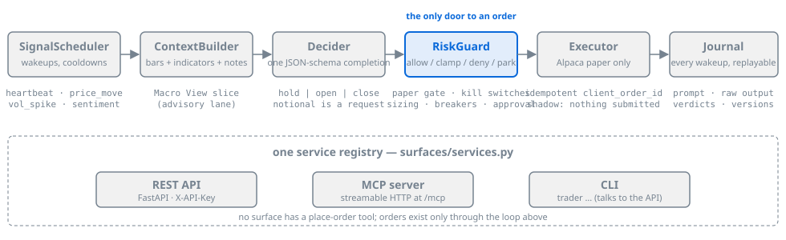

# trader

**An autonomous paper-trading agent where an LLM proposes and a deterministic RiskGuard
disposes.** The loop wakes on a signal, builds market context, asks a model for one
JSON-schema-validated decision, runs that decision through an ordered chain of pure-Python
risk checks, and journals everything. Three surfaces (REST, MCP, CLI) sit over one service
registry, and none of them has a place-order tool. Paper only, by construction.

[](https://github.com/sudoTomas/trader/actions/workflows/ci.yml)
[](LICENSE)
[](pyproject.toml)
[](https://pypi.org/project/trader-agent/)
[](https://github.com/sudoTomas/trader/pkgs/container/trader)
<!-- The PyPI badge resolves once the first vX.Y.Z tag runs .github/workflows/release.yml
     (package name: trader-agent, CLI command: trader). Until then shields.io returns
     "package not found". The GHCR badge is static because shields.io has no GHCR version
     endpoint; the image is ghcr.io/sudotomas/trader, pushed by the same workflow. -->

- **Docs index:** [`docs/README.md`](docs/README.md) · **Design:** [`docs/architecture.md`](docs/architecture.md) · **Quickstart:** [`docs/quickstart.md`](docs/quickstart.md)
- **Issues:** [sudoTomas/trader/issues](https://github.com/sudoTomas/trader/issues) · **Map of remaining work:** [`docs/tracker.md`](docs/tracker.md)

## What it does in 30 seconds

Force one decide pass, then read the journal row it wrote. With `TRADER_SHADOW_MODE=true`
(the default) the whole chain runs and nothing is submitted.

```console
$ trader wake
{
  "woken": true,
  "results": [
    {"symbol": "BTC/USD", "triggers": ["heartbeat"], "status": "shadow", "decision_id": 41, "action": "hold", "reason": ""},
    {"symbol": "ETH/USD", "triggers": ["heartbeat"], "status": "shadow", "decision_id": 42, "action": "open", "reason": ""}
  ]
}

$ trader decisions --limit 1
[
  {
    "id": 42,
    "ts": "2026-09-29T14:03:11.402518+00:00",
    "symbol": "ETH/USD",
    "asset_class": "crypto",
    "trigger": "heartbeat",
    "status": "shadow",
    "prompt": "You are the decide step of ...",
    "raw_output": "{\"action\": \"open\", \"conviction\": 0.62, \"rationale\": \"...\", \"side\": \"buy\", \"notional_usd\": 1500.0}",
    "decision": {
      "symbol": "ETH/USD",
      "action": "open",
      "conviction": 0.62,
      "rationale": "RSI 41 off a 48h low, price back above the 20-bar SMA, realized vol subdued.",
      "intent": {"symbol": "ETH/USD", "side": "buy", "qty": null, "notional": 1500.0, "order_type": "market", "limit_price": null, "time_in_force": "gtc"}
    },
    "risk_verdicts": [
      {"check": "input_sanity", "action": "allow", "reason": "", "notional": 1500.0},
      {"check": "paper_gate", "action": "allow", "reason": "paper", "notional": 1500.0},
      {"check": "kill_switch", "action": "allow", "reason": "", "notional": 1500.0},
      ...
      {"check": "approval_threshold", "action": "clamp", "reason": "clamped from 1500.00 to the 1000.00 unattended cap", "notional": 1000.0}
    ],
    "desk_verdicts": null,
    "macro_view_version": null,
    "brief_version": null,
    "cost_usd": 0.0,
    "latency_ms": 1840
  }
]
```

The model asked for $1,500; RiskGuard clamped it to the unattended cap; shadow mode
journaled the result and touched no account. `status` is one of `shadow`, `executed`,
`denied`, `pending`, `suppressed`, or `error`. A `hold` journals `risk_verdicts: null`
because nothing reached the guard. `trader decision 42` prints the full prompt.

## How it works

<p align="center">
  
</p>

| Stage | What it does |
|---|---|
| **SignalScheduler** | Event-driven wakeups (heartbeat, price move, vol spike, sentiment swing, position risk) with per-asset-class cadence, calendar gating, and cooldowns. |
| **ContextBuilder** | Fetches ~100 bars per interval on demand, computes RSI/SMA/EMA/realized vol locally, attaches the Macro View slice, X sentiment, positions, and recent journal rows. No LLM tool calls in the hot path. No market data is stored. |
| **Decider** | One completion, constrained to a JSON schema, one retry with the validation errors fed back. `notional_usd` is a request, never a size. |
| **RiskGuard** | Ordered, fail-closed chain: paper gate → kill switches → per-class policy → sizing clamps → throughput → breakers → approval threshold. Each check returns `allow`, `clamp`, or `deny`; large opens clamp to the unattended cap or park for a human. Unreadable input is a deny. |
| **Executor** | Alpaca paper only. Idempotent `client_order_id`, order row persisted before submit, fills from the trade-updates stream. |
| **Journal** | Every wakeup, including shadow and suppressed ones, writes a row with the exact prompt, raw output, verdicts, and the research versions it saw. Replay-ready. |

**One service layer, three surfaces.** Every capability is registered once in
[`src/trader/surfaces/services.py`](src/trader/surfaces/services.py) as a query or a
command, then exposed identically as a REST route, an MCP tool, and a `trader` subcommand.
Full design, including what was deliberately left out of v1 (LangGraph, stored candle
windows, a forecasting service): [`docs/architecture.md`](docs/architecture.md).

## Safety model

- **Paper only.** A live Alpaca client refuses to construct unless
  `TRADER_ALPACA_LIVE_ENABLED=true`. The default build cannot reach a live venue.
- **RiskGuard is the only door to an order.** No LLM output, MCP tool, or API caller
  places an order except through the chain. The executor accepts only
  `RiskOutcome.executable()`. Limits are code and config, never prompt text, and RiskGuard
  never reads research output: its input carries no rationale, conviction, or
  research field, and a test asserts that.
- **Shadow first.** `TRADER_SHADOW_MODE` defaults on; a shadow build constructs no broker
  object at all. New symbols, prompt edits, model swaps, and desk changes each earn their
  flip through replay, then a shadow window, then one deliberate flip:
  [`docs/runbooks/decide-change-gate.md`](docs/runbooks/decide-change-gate.md).
- **Append-only audit.** Every state-changing action writes an `audit_events` row; nothing
  in the code updates or deletes one. Breaker and pause state is DB-backed and survives
  restarts.
- **Operator brakes.** `trader risk pause` blocks every order, exits included. Daily-loss
  and weekly-drawdown breakers halt opens until an operator resumes them. Ledger drift
  against the broker pauses routing until it is reconciled or adopted.
- **Auth is mandatory.** The API and `/mcp` refuse to boot without `TRADER_API_KEY`
  unless `TRADER_AUTH_DISABLED=true` is set explicitly.

What this is not: a strategy with a track record, a guarantee of anything, or financial
advice. See [Disclaimer](#disclaimer).

## Quickstart

The shadow-only profile: Postgres in Docker, Alpaca **paper** keys, one decide endpoint,
nothing submitted. About ten minutes. The full walkthrough with expected output for each
step is [`docs/quickstart.md`](docs/quickstart.md).

```bash
git clone https://github.com/sudoTomas/trader && cd trader
uv sync --all-extras --dev                                # 1. install (Python 3.12+, uv)
docker compose -f infra/docker-compose.yml up -d db       # 2. Postgres on :5544
cp .env.example .env                                      # 3. paper keys + one decide endpoint
uv run trader doctor                                      # 4. six checks, one table, exit 0
uv run uvicorn trader.surfaces.api.app:app --port 8080    # 5. migrations apply, API listens
uv run trader health                                      # 6. {"status": "ok", ..., "db": "ok"}
uv run trader wake                                        # 7. one shadow decision per symbol
uv run trader decisions --limit 1                         # 8. read the journal row
```

`trader doctor` reads `.env` directly and probes each dependency once: Postgres and
pending migrations, a schema-constrained completion on the decide endpoint, the paper
account, one quote, the optional xAI credential, and the mode flags. A `missing` row exits
1 and names the variable to set; `degraded` alone exits 0.

Bring a decide model either way:

- **Any OpenAI-compatible `/v1`** that supports `response_format: json_schema` (OpenAI,
  Groq, Together, Ollama, vLLM, xAI): set `TRADER_DECIDE_BASE_URL`, `TRADER_DECIDE_MODEL`,
  and `TRADER_DECIDE_API_KEY`.
- **The Nemotron preset:** leave `TRADER_DECIDE_BASE_URL` empty and point
  `TRADER_NEMOTRON_BASE_URL` at a vLLM you host. The preset client sends
  `chat_template_kwargs: {enable_thinking: false}` on every request, which that endpoint
  needs; it is never sent to a vendor API.

Two deploy shapes, one runbook: [`docs/runbooks/deploy.md`](docs/runbooks/deploy.md)
(compose with `ghcr.io/sudotomas/trader`, or the API as a host systemd unit over the
compose Postgres). Flipping shadow off is its own runbook,
[`docs/runbooks/first-live-paper-trade.md`](docs/runbooks/first-live-paper-trade.md).

## Configuration

Everything is an environment variable (or a line in `.env`), prefix `TRADER_`. The flags a
new user touches first:

| Variable | Default | What it does |
|---|---|---|
| `TRADER_SHADOW_MODE` | `true` | Decide and risk-check every wakeup; submit nothing. The gate to flip last. |
| `TRADER_LOOP_ENABLED` | `false` | Run the decide loop inside the API process. Off, the surfaces serve but nothing ticks. |
| `TRADER_LOOP_SYMBOLS` | `BTC/USD,ETH/USD` | What the loop watches. Crypto trades 24/7, so a first run works at any hour. |
| `TRADER_DECIDE_BASE_URL` / `_MODEL` / `_API_KEY` | *(empty)* | Any OpenAI-compatible decide endpoint. Empty selects the Nemotron preset. |
| `ALPACA_API_KEY_ID` / `ALPACA_API_SECRET` | *(empty)* | Alpaca **paper** keys; the same pair serves broker and market data. |
| `TRADER_API_KEY` / `TRADER_AUTH_DISABLED` | *(empty)* / `false` | Bearer key for REST and MCP. Without a key the API refuses to boot unless auth is explicitly disabled. |
| `TRADER_RISK_APPROVAL_NOTIONAL_USD` | `1000` | Unattended opens above this clamp down to it; `TRADER_RISK_PARK_ABOVE_USD` parks larger ones for a human instead. |
| `TRADER_ALPACA_LIVE_ENABLED` | `false` | The paper gate. Leave it unset. |

The complete reference is generated from the `Settings` model and checked in CI:
[`docs/configuration.md`](docs/configuration.md). `.env.example` carries every variable
with a comment.

## Surfaces

**REST** (FastAPI). Every request except `GET /health` carries `X-API-Key`.

```bash
curl -s -H "X-API-Key: $TRADER_API_KEY" "http://localhost:8080/decisions?limit=1"
curl -s -X POST -H "X-API-Key: $TRADER_API_KEY" http://localhost:8080/loop/wake
```

**MCP** (FastMCP, streamable HTTP at `/mcp`, same header). One tool per registered
capability: queries read as `get_<name>`, commands keep their name. An excerpt:

```
get_health  get_decisions  get_decision  get_positions  get_orders  get_risk_status
get_loop_status  get_macro_view  get_research_notes  get_brief  get_sentiment
get_eval_runs  get_usage  get_audit  get_config
wake_trader  pause  resume  resume_breaker  resolve_approval
submit_research_note  retire_note  compile_macro_view  fetch_x_sentiment
run_replay_eval  reconcile  flatten_all (confirm-gated)
```

**CLI** (`trader …`). Wraps the same registry over the API for operators.

```bash
trader risk status          # kill switches, breaker halts, configured limits
trader loop status          # shadow/live mode and counters
trader config show          # effective settings by section; * = differs from default
trader broker reconcile     # {"drift": {}} or a pause until resolved
```

There is deliberately **no place-order tool on any surface**. Orders exist only as the
output of the RiskGuarded loop. An external agent (Hermes or any MCP/HTTP client) can feed
research and read state, nothing else: [`docs/hermes/README.md`](docs/hermes/README.md).

## Research desk

Operators feed hand-picked research as immutable markdown notes (`trader note add`,
`POST /research/notes`, `submit_research_note`). A compiler role recompiles a versioned
**Macro View** on note change: every claim cites note ids, contradictions are preserved as
disputed rather than resolved by the model, price levels are frozen as examples, and
unpinned notes auto-stale out. The decide prompt receives a budgeted slice in its own
lane; RiskGuard never sees it, so research shapes direction and conviction, never sizing
or breakers. Every decision journals the `macro_view_version` it read.
[`docs/runbooks/research-capture.md`](docs/runbooks/research-capture.md).

## Decision desk

Off by default (`TRADER_DESK_ENABLED`). When on, analysts fan out with `asyncio.gather`
and a cross-model **critic** reviews the draft before RiskGuard. The critic's whole
vocabulary is `approve`, `shrink(notional)`, or `veto(reason)`: it has no field for side,
symbol, action, or a larger size, so it is structurally unable to enlarge or redirect a
trade. An unavailable critic is a journaled `pass_through`, never a blocked decide. Its
spend is capped per day (`TRADER_DESK_CRITIC_DAILY_USD`). The desk earned its flip by
replaying the same window desk-on versus desk-off: [`docs/runbooks/decide-change-gate.md`](docs/runbooks/decide-change-gate.md).

## Sentiment

X sentiment runs server-side on xAI (`x_search`) for held symbols only, every three hours
by default, under a daily call cap; without an xAI credential it stays off. Scores land
in the journal as numbers on [-1, 1] or as an honest `unavailable`. A sentiment swing can
wake the loop, but that trigger (`TRADER_SENTIMENT_TRIGGER_ENABLED`) is dark by default
and is meant to stay dark until a week of journaled scores looks sane. `trader sentiment
history` shows what it produced.

## Replay harness

Before any decide-behavior change, replay a window under the current config and under
the candidate, then compare:

```bash
trader eval run --symbol BTC/USD --start 2026-08-18T00:00:00+00:00 \
    --end 2026-08-25T00:00:00+00:00 --label baseline
trader eval list
trader eval show <id>
```

Bars come from a small read-through cache, the decider is the code the live loop runs,
and results land only in `eval_runs` / `eval_steps`, never near an order path. The PnL in
a summary is mark-to-bars with no costs or slippage: it ranks configurations, it does not
predict live results. `--desk` replays the same window through the decision desk.

## Status and roadmap

Pre-1.0. The loop has run live-paper on the maintainer's machine since September 2026 with
two symbols (ETH/USD and SPY, desk on, sentiment trigger armed). What has actually
traded: one $1,000 SPY buy, one ETH/USD open that the critic shrank from $1,000 to $500
and that closed six days later for a gain of roughly $11, and a second small ETH/USD open
still held. Three oversized drafts parked at the approval threshold and were denied by
the operator. Paper equity has stayed within a few hundredths of a percent of the
$100,000 starting balance. That is a working control loop, not a track record.

Remaining work is mapped in [`docs/tracker.md`](docs/tracker.md). The epics:

- [#19](https://github.com/sudoTomas/trader/issues/19) M5 expansion: commodity ETFs, screener, more asset classes.
- [#20](https://github.com/sudoTomas/trader/issues/20) Grok macro desk seats.
- [#21](https://github.com/sudoTomas/trader/issues/21) Money-path honesty: every inert path either works or says so.
- [#35](https://github.com/sudoTomas/trader/issues/35) Open-source release: MIT, public after cleanup, Python stays.

Decide-behavior gates that are queued and not agent work: briefs into the decide lane
([#1](https://github.com/sudoTomas/trader/issues/1)) and an exit-review lane
([#34](https://github.com/sudoTomas/trader/issues/34)).

## Contributing

Read [`CONTRIBUTING.md`](CONTRIBUTING.md) and [`CODE_OF_CONDUCT.md`](CODE_OF_CONDUCT.md).
The short version:

- Failing test first when the change has behavior. Before every commit:
  `uv run ruff format . && uv run ruff check . && uv run pytest -q`. Tests need the compose
  Postgres and create a `<db>_test` sibling; do not point them at a database you cannot wipe.
- Add a capability to `surfaces/services.py` first, then wire REST, MCP, and CLI. Never
  one surface only, never a raw place-order tool.
- A prompt edit, model swap, new prompt lane, or risk-chain change is a decide-behavior
  change and goes through the [decide-change gate](docs/runbooks/decide-change-gate.md):
  replay, shadow window, one flip, one gate at a time.
- Do not weaken the paper gate, the pins in `tests/conftest.py`, or the append-only audit.

## Security

Report vulnerabilities privately per [`SECURITY.md`](SECURITY.md). Anything that weakens
the paper-only gate, submits an order around RiskGuard, or leaks a credential counts.

## License

[MIT](LICENSE).

## Disclaimer

This is paper-trading software, not financial advice. It is provided without warranty
(see [LICENSE](LICENSE)). Live trading is hard-gated (`TRADER_ALPACA_LIVE_ENABLED`) and
unsupported.
