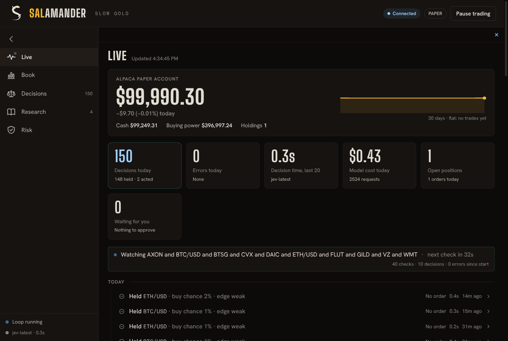

# Desk (Salamander)

A desktop window for trader. Open it and it attaches to the API already running on
this machine, then shows what the agent is doing. It does not start a backend. It is
a client of the API: it adds no trading logic, and RiskGuard still decides every order.



## What it does

- **On launch:** it connects to the API already listening on the desk port. If nothing
  answers `/health`, the window says so and starts nothing — not Postgres, not uvicorn.
- **On close:** the window quits. It does not stop trader-api.
- **Live:** today's tiles (decisions, errors, average decision time, model cost, open
  positions, approvals waiting), a live line with a countdown to the next check, and a
  ledger of every decision and audit event grouped by day. Click a row for the model's
  reasoning and RiskGuard's verdicts.
- **Book:** approvals waiting, positions at the broker, positions in trader's ledger, orders.
- **Decisions:** every call in a table.
- **Research:** the Macro View with its note citations, and the research notes.
- **Risk:** risk state, limits and model usage.

## What it can change

Pause and resume trading, and approve or deny a pending approval. Both ask for
confirmation. The main process allows exactly three POST routes
(`/risk/pause`, `/risk/resume`, `/risk/approvals/{id}/resolve`) and refuses every other
one, so flatten-all, reconcile, adopt and wake can't be triggered from the window. Use the
CLI for those.

## Broker reads

Trader has no account endpoint yet, so the Live band and the Book's "At the broker" table
read the Alpaca **paper** account directly with the paper keys from the settings file:
`GET /v2/account`, `/v2/positions` and `/v2/account/portfolio/history`. Only those three
GET paths exist in the client, so nothing it does can trade. Error bodies from Alpaca are
not passed to the page.

## Setup

```bash
cd clients/desk
npm install                # also downloads the Electron binary
./install-desktop.sh       # adds "Salamander" to the desktop app launcher (freedesktop)
npm start                  # or run it straight from a terminal
```

Needs a trader API already listening on the desk port (`trader-api`, or uvicorn you started yourself).

## Settings

Environment variables, all optional:

| Variable | Default | Purpose |
|---|---|---|
| `TRADER_DIR` | the checkout this folder sits in | trader checkout to run |
| `TRADER_DESK_ENV_FILE` | `$TRADER_DIR/.env` | trader's settings file. Point it outside every checkout to keep live settings away from tests. |
| `TRADER_DESK_PORT` | `8080` | API port |
| `TRADER_API_KEY` | read from the settings file | sent as `X-API-Key` when auth is on |

## Look

The desk carries the Salamander identity proposed for the project (see the naming issue).
`brand/salamander.html` is the brand sheet.

- **Colour means something.** Salamander yellow `#F5B82E` is fixed: accepted, held, earned,
  and the primary action. Blue flame `#62B6FF` is live and volatile: the running loop, the
  model's proposals, the connection. Scorch `#EF5A4C` is for failures only; losses read in
  ash with a minus sign. The ground is salamander-skin black `#0D0B0A`, text is salt white
  `#EFE9DF`.
- **Type:** Big Shoulders Display (wordmark, headings, big numbers), Hanken Grotesk
  (interface, tabular figures), Fragment Mono (symbols and IDs). All three are bundled under
  `fonts/` with their OFL license.
- **Mark:** a fire salamander seen from above, its body an S, gold spots on the spine.
  `python3 brand/make_mark.py` regenerates the SVGs; the launcher icon is
  `brand/salamander-icon.png`.

## Files

- `main.js`: owns the window and forwards API calls. GET must stay on `127.0.0.1` and the desk port. POST is the three-route allowlist. Redirects are refused.
- `desk_logic.js`: that route check, plus the approval toast and ledger wording
- `preload.js`: the only bridge the page gets (`get`, `post`, `broker`, backend status)
- `index.html`, `renderer.js`, `style.css`, `icons.js`: the dashboard
- `install-desktop.sh`: launcher entry
