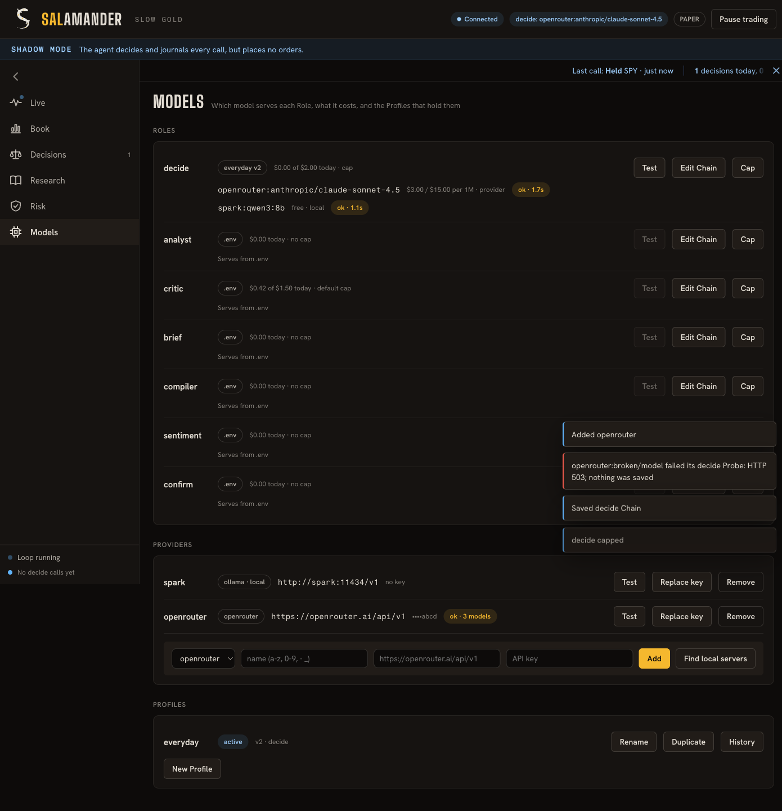
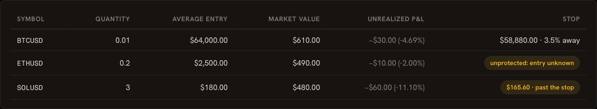

# Desk (Salamander)

A desktop window for trader. Open it and it attaches to the API already running on
this machine, then shows what the agent is doing. It does not start a backend. It is
a client of the API: it adds no trading logic, and RiskGuard still decides every order.


## What it does

- **On launch:** it connects to the API already listening on the desk port. If nothing
  answers `/health`, the window says so and starts nothing — not Postgres, not uvicorn.
- **On close:** the window quits. It does not stop trader-api.
- **Live:** today's tiles (decisions, errors, average decision time, model cost, open
  positions, approvals waiting), a live line with a countdown to the next check, and a
  ledger of every decision and audit event grouped by day. Click a row for the model's
  reasoning and RiskGuard's verdicts.
- **Book:** approvals waiting, positions at the broker, positions in trader's ledger, orders.
- **Decisions:** every call in a table.
- **Research:** the Macro View with its note citations, and the research notes.
- **Risk:** risk state, limits, the stop-loss setting and any position it cannot protect,
  and model usage. The Book's broker holdings show each position's stop and how far the
  price is from it.
- **Models:** each Role's Chain with prices, today's spend against its cap, and an
  on-demand Probe; Providers (add, test, replace key, remove, find local servers);
  Profiles (switch, rename, duplicate, history and revert). The header chip names the
  decide model, and a decision's detail names the model and Profile version that served it.

- **Settings:** every setting the trader runs with, by section, with the values that
  differ from their default highlighted. Read-only; credentials show only set or not set.





## What it can change

Pause and resume trading, approve or deny a pending approval, and everything on the
Models page. The main process allows each write by method and exact path
(`ALLOWED_WRITES` in `desk_logic.js`): the three risk POSTs, plus the model-picker routes
under `/providers`, `/profiles`, `/roles/{role}/probe` and `/caps`. Every other write is
refused, so flatten-all, reconcile, adopt and wake can't be triggered from the window. Use
the CLI for those. A Provider key is typed into a password field, sent once in the request
body, and never returned by the API. Changes are audited with the surface `desk`.

## Broker reads

Trader has no account endpoint yet, so the Live band and the Book's "At the broker" table
read the Alpaca **paper** account directly with the paper keys from the settings file:
`GET /v2/account`, `/v2/positions` and `/v2/account/portfolio/history`. Only those three
GET paths exist in the client, so nothing it does can trade. Error bodies from Alpaca are
not passed to the page.

## Setup

```bash
cd clients/desk
npm install                # also downloads the Electron binary
./install-desktop.sh       # adds "Salamander" to the desktop app launcher (freedesktop)
npm start                  # or run it straight from a terminal
```

Needs a trader API already listening on the desk port (`trader-api`, or uvicorn you started yourself).

To watch an API running on another machine, point the desk at it and give it a settings
file of its own, outside any checkout, holding just `TRADER_API_KEY`, `ALPACA_API_KEY_ID`
and `ALPACA_API_SECRET`:

```bash
TRADER_DESK_URL=http://192.168.1.20:8080 \
TRADER_DESK_ENV_FILE=~/.config/trader/desk.env \
npm start
```

The API key travels as plain HTTP, so use this on your own LAN or through an SSH tunnel
(`ssh -L 8080:127.0.0.1:8080 host`, then the default URL works).

## Settings

Environment variables, all optional:

| Variable | Default | Purpose |
|---|---|---|
| `TRADER_DIR` | the checkout this folder sits in | trader checkout to run |
| `TRADER_DESK_ENV_FILE` | `$TRADER_DIR/.env` | trader's settings file. Point it outside every checkout to keep live settings away from tests. |
| `TRADER_DESK_PORT` | `8080` | API port on this machine |
| `TRADER_DESK_URL` | `http://127.0.0.1:$TRADER_DESK_PORT` | Full API base URL; set it to watch an API on another machine |
| `TRADER_API_KEY` | read from the settings file | sent as `X-API-Key` when auth is on |

## Look

The desk carries the project's Salamander identity ([`docs/brand.md`](../../docs/brand.md)).
`brand/salamander.html` is the brand sheet.

- **Colour means something.** Salamander yellow `#F5B82E` is fixed: accepted, held, earned,
  and the primary action. Blue flame `#62B6FF` is live and volatile: the running loop, the
  model's proposals, the connection. Scorch `#EF5A4C` is for failures only; losses read in
  ash with a minus sign. The ground is salamander-skin black `#0D0B0A`, text is salt white
  `#EFE9DF`.
- **Type:** Big Shoulders Display (wordmark, headings, big numbers), Hanken Grotesk
  (interface, tabular figures), Fragment Mono (symbols and IDs). All three are bundled under
  `fonts/` with their OFL license.
- **Mark:** a fire salamander seen from above, its body an S, gold spots on the spine.
  `python3 brand/make_mark.py` regenerates the SVGs; the launcher icon is
  `brand/salamander-icon.png`.

## Files

- `main.js`: owns the window and forwards API calls. GET must stay on the API's own host and port (loopback unless `TRADER_DESK_URL` says otherwise). Writes (POST, PUT, DELETE) are the method-and-path allowlist. Redirects are refused.
- `desk_logic.js`: that route check, plus the approval toast and ledger wording
- `preload.js`: the only bridge the page gets (`get`, `post`, `put`, `del`, `broker`, backend status)
- `models.js`: the Models page
- `index.html`, `renderer.js`, `style.css`, `icons.js`: the dashboard
- `install-desktop.sh`: launcher entry
